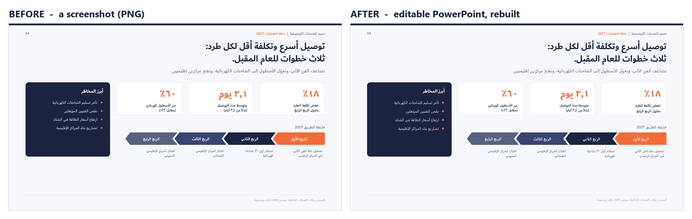

<p align="center"></p>

<h1 align="center">unscreenshot</h1>

<p align="center"><b>ย้อนภาพหน้าจอ เอาสไลด์คืนมา</b><br>
ใส่ภาพหน้าจอเข้าไป ได้ PowerPoint ที่แก้ไขได้ออกมา แม่นยำระดับพิกเซล รองรับทุกภาษา</p>

<p align="center">
  <a href="../../README.md" title="English">🇬🇧</a> ·
  <a href="README.fr.md" title="Français">🇫🇷</a> ·
  <a href="README.zh-CN.md" title="简体中文">🇨🇳</a> ·
  <a href="README.es.md" title="Español">🇪🇸</a> ·
  <a href="README.pt-BR.md" title="Português (Brasil)">🇧🇷</a> ·
  <a href="README.ja.md" title="日本語">🇯🇵</a> ·
  <a href="README.vi.md" title="Tiếng Việt">🇻🇳</a> ·
  <a href="README.ko.md" title="한국어">🇰🇷</a> ·
  <a href="README.fa.md" title="فارسی">🇮🇷</a> ·
  <b title="ไทย">🇹🇭</b> ·
  <a href="README.ar.md" title="العربية">🇸🇦</a>
</p>

<p align="center">
  <a href="../../LICENSE"></a>
  <a href="https://github.com/zaidlemouakni/unscreenshot/actions/workflows/ci.yml"></a>
  
</p>


คุณมีแค่ภาพของสไลด์: ภาพหน้าจอจากการประชุม สไลด์ที่ AI สร้างออกมาเป็นรูปภาพ หน้าหนึ่งจาก PDF หรือชุดสไลด์ที่มีคนส่งมาเป็นรูป คุณต้องการไฟล์ PowerPoint แต่ไฟล์หายไปแล้ว หรือไม่เคยมีมาตั้งแต่แรก

`unscreenshot` คือ**สกิลสำหรับเอเจนต์ AI**: ส่งภาพให้ผู้ช่วย AI ของคุณ แล้วรับไฟล์ `.pptx` กลับมา โดยทุกกล่องข้อความ หัวข้อย่อย การ์ด เส้น และสี ถูกวัดจากภาพแล้วสร้างขึ้นใหม่เป็นวัตถุ PowerPoint ดั้งเดิมที่แก้ไขได้

## ติดตั้งใน 30 วินาที

วางข้อความนี้ในเอเจนต์ที่ติดตั้งสกิลได้ (Claude Code, Codex, Gemini CLI, Cursor, Copilot…):

```text
ติดตั้งสกิล unscreenshot จาก https://github.com/zaidlemouakni/unscreenshot โดยทำตามไฟล์ AGENTS.md ของรีโพ
```

หรือเลือกแพลตฟอร์มของคุณ:

| คุณใช้ AI ที่ไหน | วิธีติดตั้ง |
|---|---|
| **Claude** (claude.ai) | Settings > Capabilities: เปิดการรันโค้ด แล้วไปที่ Skills > อัปโหลด [`unscreenshot.zip`](https://github.com/zaidlemouakni/unscreenshot/releases/latest) |
| **ChatGPT** (Business, Enterprise, Edu) | Skills > อัปโหลด zip ไฟล์เดียวกัน |
| **Gemini** (app) | Skills > อัปโหลด zip ไฟล์เดียวกัน |
| **Microsoft Copilot Studio** | Agent > Build > Skills > Upload a skill > เลือกไฟล์ zip |
| **Claude Code** | `claude plugin marketplace add zaidlemouakni/unscreenshot` แล้วตามด้วย `claude plugin install unscreenshot@unscreenshot` |
| **Codex** | `codex plugin marketplace add zaidlemouakni/unscreenshot --ref main` แล้วตามด้วย `codex plugin add unscreenshot@unscreenshot` |
| **Gemini CLI** | `gemini extensions install https://github.com/zaidlemouakni/unscreenshot` |
| **Mistral Vibe** | คัดลอก `skills/unscreenshot` ไปไว้ใน `~/.vibe/skills/` |
| **GitHub Copilot, Cursor, OpenCode…** | `npx skills add zaidlemouakni/unscreenshot` |

เมนู โฟลเดอร์ และขั้นตอนของแต่ละแพลตฟอร์ม: [INSTALL](../install/INSTALL.th.md) (ชื่อเมนูเขียนเป็นภาษาอังกฤษ)

## ลองใน 60 วินาที

1. ติดตั้งสกิลสำหรับแพลตฟอร์มของคุณ (ด้านบน)
2. บันทึก[ภาพหน้าจอตัวอย่าง](../../examples/demo/source.png) หรือใช้ภาพสไลด์ใดก็ได้ที่คุณมี
3. แนบภาพแล้วขอเป็นภาษาของคุณเอง:
   > ช่วยสร้างสไลด์นี้ใหม่เป็น PowerPoint ที่แก้ไขได้ ให้เหมือนต้นฉบับทุกอย่าง
4. เปิดไฟล์ `.pptx` แล้วคลิกที่หัวเรื่อง: นั่นคือกล่องข้อความจริง ไม่ใช่รูปภาพ

คุณยังได้ภาพเปรียบเทียบก่อน/หลังด้วย หากมีหลายภาพ หรือ PDF หลายหน้า แต่ละหน้าจะกลายเป็นหนึ่งสไลด์ในไฟล์เดียวกัน

## ใช้ได้กับภาษาของคุณ



ภาษาอาหรับ เปอร์เซีย และฮีบรู (เขียนจากขวาไปซ้าย) ภาษาจีน ญี่ปุ่น เกาหลี ฮินดี ไทย เวียดนาม รัสเซีย กรีก และทุกภาษาที่เขียนด้วยอักษรละติน

- ข้อความคงไว้ทุกคำ ในระบบอักษรเดิม ไม่มีการแปลใด ๆ
- สไลด์ที่เขียนจากขวาไปซ้ายยังคงเลย์เอาต์แบบกลับด้าน: หัวข้อย่อยอยู่ทางขวา แผนงานชี้ไปทางซ้าย
- แต่ละระบบอักษรได้ฟอนต์ที่ PowerPoint ใช้กับอักษรนั้น และขนาดถูกวัดตามวิธีที่อักษรนั้นถูกวาดจริง

ตัวอย่างฉบับเต็ม: [ภาษาอาหรับ](../../examples/arabic) · [ภาษาญี่ปุ่น](../../examples/japanese) · [สิบสองระบบอักษรในสไลด์เดียว](../../examples/languages)

## สิ่งที่คุณจะได้รับ


- **วัตถุดั้งเดิมที่แก้ไขได้**: กล่องข้อความที่มีข้อความจริง หัวข้อย่อยจริง สี่เหลี่ยม การ์ดมุมมน รูปแคปซูล วงกลม ลูกศรเชฟรอน เส้น และกลุ่ม เปลี่ยนคำ เปลี่ยนสีการ์ด ย้ายบล็อก: มันคือสไลด์ธรรมดาทั่วไป
- **วัดจริง ไม่ได้เดา**: ตำแหน่ง ขนาด และสีมาจากการวัดระดับพิกเซล ขนาดฟอนต์ถูกคำนวณให้แต่ละบรรทัดกว้างเท่ากับในภาพ
- **มีหลักฐาน**: ภาพต้นฉบับกับสไลด์ที่สร้างใหม่วางเทียบกัน พร้อมภาพซ้อนทับของทั้งสอง

## ทำไมไม่ใช้ OCR ตัวแปลง PDF หรือเครื่องมือสร้างสไลด์ด้วย AI?

OCR ให้ข้อความ ไม่ใช่สไลด์ ตัวแปลงต้องใช้ PDF ต้นฉบับ เครื่องมือสร้างสไลด์ทำสไลด์ใหม่ขึ้นมา ส่วน unscreenshot คืนสไลด์ที่คุณมีอยู่กลับมาให้คุณ

| | OCR | ตัวแปลง PDF | เครื่องมือสร้างสไลด์ด้วย AI | **unscreenshot** |
|---|:-:|:-:|:-:|:-:|
| เริ่มจากภาพหน้าจอหรือภาพถ่าย | ✅ | ❌ | ❌ | ✅ |
| เก็บทุกคำไว้ตามเดิม | ✅ | ✅ | ❌ | ✅ |
| เลย์เอาต์ ตำแหน่ง และขนาดเหมือนเดิม | ❌ | ⚠️ | ❌ | ✅ |
| รูปทรงดั้งเดิม การ์ด และหัวข้อย่อยจริง | ❌ | ⚠️ | ✅ | ✅ |
| การเขียนจากขวาไปซ้ายและอักษรที่ไม่ใช่ละติน | ⚠️ | ⚠️ | ⚠️ | ✅ |

⚠️ ขึ้นอยู่กับเครื่องมือและไฟล์

## หลักการทำงาน

ผู้ช่วย (โมเดลใดก็ได้ที่มองเห็นภาพ) ทำหน้าที่อ่านและตัดสินใจ ส่วนสคริปต์ Python ขนาดเล็กที่ผ่านการทดสอบทำหน้าที่วัดและสร้าง

1. **วิเคราะห์**: หาทุกบรรทัดข้อความ รูปทรงที่เติมสี เส้นคั่น จุดหัวข้อย่อย และไอคอน แล้ววัดเส้นฐาน ความกว้างของหมึก และสี
2. **อ่าน**: โมเดลถอดข้อความทีละบรรทัดจากภาพที่ขยาย และระบุว่าแต่ละองค์ประกอบคืออะไร
3. **สเปก**: โมเดลเขียนคำอธิบายสไลด์เป็น JSON โดยอิงกับค่าที่วัดได้
4. **ปรับขนาด**: คำนวณขนาดฟอนต์ให้ความกว้างของหมึกในแต่ละข้อความตรงกับภาพ แยกตามระบบอักษร
5. **สร้าง**: ตัวสร้างที่ไม่พึ่งไลบรารีภายนอกจะผลิตไฟล์ `.pptx` (ใช้แค่ Pillow และ numpy)
6. **ตรวจสอบ**: เรนเดอร์สไลด์ (LibreOffice หรือ PowerPoint) เทียบกับภาพ แล้วแก้ไข สูงสุดสามรอบ

ในตัวอย่างทั้งสี่ของรีโพนี้ หลังแก้ไขหนึ่งรอบ ทุกข้อความคลาดจากต้นฉบับไม่เกิน 1 พิกเซล

## ข้อจำกัด

- **ฟอนต์**: หากภาพใช้ฟอนต์ที่ไม่มีใน Office (Poppins, Inter, Noto…) จะใช้ฟอนต์ Office ที่ใกล้เคียงที่สุดแทน ตำแหน่ง ขนาด และความกว้างของบรรทัดยังตรงกัน แต่รูปทรงตัวอักษรต่างไปเล็กน้อย
- **ไอคอน โลโก้ และรูปถ่าย** จะถูกตัดมาจากภาพ (ทำพื้นหลังโปร่งใส) ไม่ได้วาดใหม่
- **ข้อความภาษาญี่ปุ่นหรือจีนแนวตั้ง** จะคงไว้เป็นรูปภาพ
- ผู้ช่วยของคุณต้อง**รัน Python ได้** (การรันโค้ด) หากทำไม่ได้ จะต้องใช้เซิร์ฟเวอร์ MCP ที่วางแผนไว้สำหรับเวอร์ชัน 2

## คำถามที่พบบ่อย

**ฟรีไหม?**\
ฟรี: สัญญาอนุญาต MIT ไม่ต้องมีบัญชี ไม่ต้องใช้คีย์ API ทำงานอยู่ในผู้ช่วย AI ที่คุณใช้อยู่แล้ว

**สไลด์ของฉันจะออกจากเครื่องไหม?**\
ตัวสกิลไม่มีการเชื่อมต่อเครือข่ายใด ๆ: สคริปต์ทำงานในแซนด์บ็อกซ์ของผู้ช่วยหรือบนเครื่องของคุณ ผู้ช่วยจะเห็นภาพ เหมือนไฟล์อื่นใดที่คุณส่งให้

**ใช้กับผู้ช่วยตัวไหนได้บ้าง?**\
ผู้ช่วยใดก็ได้ที่ดูภาพและรัน Python ได้: ตัวที่อยู่ในตารางการติดตั้ง และตัวอื่นที่อ่านรูปแบบ `SKILL.md` ได้ การอ่านตัวอักษรเล็กขึ้นอยู่กับความสามารถด้านการมองเห็นของโมเดล: โมเดลที่เก่งกว่าอ่านได้แม่นกว่า

**ถ้ามีรายละเอียดไม่ตรงล่ะ?**\
สกิลจะเรนเดอร์ผลลัพธ์ เปรียบเทียบกับภาพของคุณ แล้วแก้ไข สูงสุดสามรอบ จากนั้นจะบอกคุณว่ายังมีอะไรที่ต่างอยู่ ทุกอย่างแก้ไขได้ การเก็บงานขั้นสุดท้ายจึงใช้เวลาไม่กี่วินาที

**ทำไมไม่วางภาพลงใน PowerPoint ไปเลย?**\
แบบนั้นก็เป็นแค่รูปภาพ: แก้คำสักคำ แก้ตัวเลข หรือนำการ์ดไปใช้ซ้ำไม่ได้

**ช่วยปรับสไลด์ให้ดีขึ้นหรือแปลให้ได้ไหม?**\
สกิลจะไม่ทำเอง และตั้งใจให้เป็นแบบนั้น: สร้างใหม่ตามที่เห็นในภาพทุกคำ รวมถึงคำที่พิมพ์ผิด เมื่อได้ PowerPoint จริงแล้ว ค่อยขอให้ผู้ช่วยแก้ไขตามที่ต้องการ

โค้ด เทสต์ และตัวอย่าง: ดู[ตารางโครงสร้างรีโพ](../../README.md#repository) ใน README ภาษาอังกฤษ ยินดีรับการปรับปรุงคำแปล: [CONTRIBUTING.md](../../CONTRIBUTING.md)

## สัญญาอนุญาต

MIT.

*กดดาวให้หน่อย ถ้ามันช่วยให้คุณไม่ต้องทำสไลด์ใหม่ด้วยมือ*
