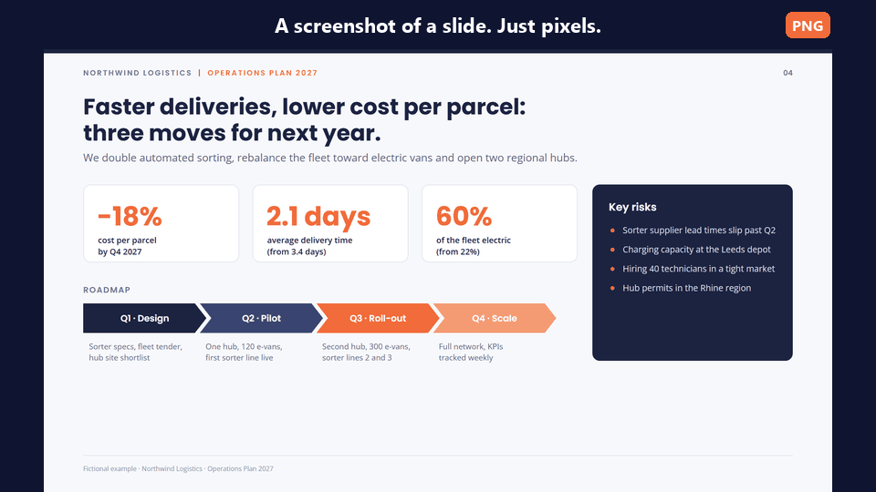
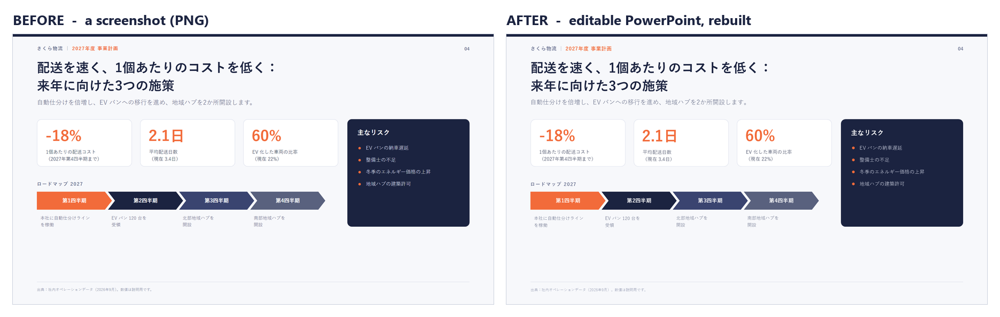
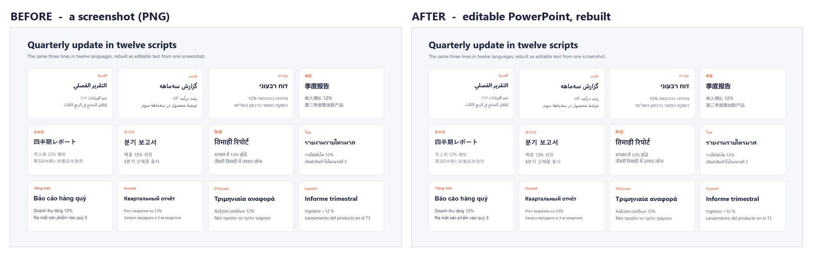

<p align="center"></p>

<h1 align="center">unscreenshot</h1>

<p align="center"><b>撤销截图，找回幻灯片。</b><br>
输入截图，输出可编辑的 PowerPoint，像素级还原，支持任何语言。</p>

<p align="center">
  <a href="../../README.md" title="English">🇬🇧</a> ·
  <a href="README.fr.md" title="Français">🇫🇷</a> ·
  <b title="简体中文">🇨🇳</b> ·
  <a href="README.es.md" title="Español">🇪🇸</a> ·
  <a href="README.pt-BR.md" title="Português (Brasil)">🇧🇷</a> ·
  <a href="README.ja.md" title="日本語">🇯🇵</a> ·
  <a href="README.vi.md" title="Tiếng Việt">🇻🇳</a> ·
  <a href="README.ko.md" title="한국어">🇰🇷</a> ·
  <a href="README.fa.md" title="فارسی">🇮🇷</a> ·
  <a href="README.th.md" title="ไทย">🇹🇭</a> ·
  <a href="README.ar.md" title="العربية">🇸🇦</a>
</p>

<p align="center">
  <a href="../../LICENSE"></a>
  <a href="https://github.com/zaidlemouakni/unscreenshot/actions/workflows/ci.yml"></a>
  
</p>



你手里只有一张幻灯片的图片：会议上的截图、AI 生成的图片式幻灯片、PDF 里的一页、别人发来的图片版演示文稿。你需要的是 PowerPoint 文件，可它已经找不到了，或者根本就不存在。

`unscreenshot` 是一个**智能体技能（skill）**：把图片交给你的 AI 助手，就能拿回一个 `.pptx`。其中每个文本框、项目符号、卡片、线条和颜色都在图片上精确测量，并重建为原生、可编辑的 PowerPoint 对象。

## 30 秒安装

把下面这段话粘贴到任何能安装技能的智能体中（Claude Code、Codex、Gemini CLI、Cursor、Copilot…）：

```text
请从 https://github.com/zaidlemouakni/unscreenshot 安装 unscreenshot 技能，并按照仓库中的 AGENTS.md 操作。
```

或者选择你的平台：

| 你在哪里使用 AI | 安装方法 |
|---|---|
| **Claude** (claude.ai) | Settings > Capabilities：开启代码执行，然后 Skills > 上传 [`unscreenshot.zip`](https://github.com/zaidlemouakni/unscreenshot/releases/latest) |
| **ChatGPT** (Business, Enterprise, Edu) | Skills > 上传同一个 zip |
| **Gemini** (app) | Skills > 上传同一个 zip |
| **Microsoft Copilot Studio** | Agent > Build > Skills > Upload a skill > 选择该 zip |
| **Claude Code** | `claude plugin marketplace add zaidlemouakni/unscreenshot`，然后 `claude plugin install unscreenshot@unscreenshot` |
| **Codex** | `codex plugin marketplace add zaidlemouakni/unscreenshot --ref main`，然后 `codex plugin add unscreenshot@unscreenshot` |
| **Gemini CLI** | `gemini extensions install https://github.com/zaidlemouakni/unscreenshot` |
| **Mistral Vibe** | 把 `skills/unscreenshot` 复制到 `~/.vibe/skills/` |
| **GitHub Copilot, Cursor, OpenCode…** | `npx skills add zaidlemouakni/unscreenshot` |

各平台的菜单、文件夹和详细步骤：[INSTALL](../install/INSTALL.zh-CN.md)（菜单名称以英文标注）。

## 60 秒上手

1. 为你的平台安装技能（见上文）。
2. 保存[示例截图](../../examples/demo/source.png)，或者用任意一张幻灯片图片。
3. 附上图片，用你自己的语言提出要求：
   > 把这页幻灯片重建为可编辑的 PowerPoint，保持完全一致。
4. 打开 `.pptx`，点击标题：它是真正的文本框，不是图片。

你还会得到一张前后对比图。多张图片或多页 PDF，会在同一个文件里各生成一页幻灯片。

## 支持你的语言



阿拉伯语、波斯语和希伯来语（从右到左书写）、中文、日语、韩语、印地语、泰语、越南语、俄语、希腊语，以及所有使用拉丁字母的语言。

- 文字逐字保留，保持原有的书写系统，不做任何翻译。
- 从右到左的幻灯片保留镜像布局：项目符号在右侧，路线图指向左边。
- 每种文字都使用 PowerPoint 为它选用的字体，字号也按照该文字的实际排版方式测量。

完整示例：[阿拉伯语](../../examples/arabic) · [日语](../../examples/japanese) · [一页幻灯片上的十二种文字](../../examples/languages)。

## 你会得到什么



- **原生、可编辑的对象**：带真实文字的文本框、真正的项目符号、矩形、圆角卡片、胶囊形、圆形、箭头、线条和组合。改一个词、给卡片换个颜色、移动一个区块——它就是一页普通的幻灯片。
- **测量而非猜测**：位置、尺寸和颜色都来自像素级测量。字号经过计算，使每一行的宽度与图片中完全相同。
- **有据可查**：原图与重建后的幻灯片并排对比，并附叠加图。

## 为什么不用 OCR、PDF 转换器或 AI 幻灯片生成器？

OCR 给你的是文字，不是幻灯片。转换器需要原始 PDF。生成器做出的是一页新幻灯片。unscreenshot 还给你的，是你手上的那一页。

| | OCR | PDF 转换器 | AI 幻灯片生成器 | **unscreenshot** |
|---|:-:|:-:|:-:|:-:|
| 直接从截图或照片开始 | ✅ | ❌ | ❌ | ✅ |
| 每个字都原样保留 | ✅ | ✅ | ❌ | ✅ |
| 版式、位置和尺寸一致 | ❌ | ⚠️ | ❌ | ✅ |
| 原生形状、卡片和真正的项目符号 | ❌ | ⚠️ | ✅ | ✅ |
| 从右到左书写和非拉丁文字 | ⚠️ | ⚠️ | ⚠️ | ✅ |

⚠️ 取决于具体工具和文件。

## 工作原理

助手（任何能看图的模型）负责阅读和判断；经过测试的小型 Python 脚本负责测量和构建。

1. **分析**：找出每一行文字、填充形状、线条、项目符号和图标；测量基线、墨迹宽度和颜色。
2. **阅读**：模型根据放大的裁剪图逐行转录文字，并判断每个元素的类型。
3. **描述**：模型编写一份基于测量结果的幻灯片 JSON 描述。
4. **拟合**：按文字逐一计算字号，使每段文字的墨迹宽度与图片一致。
5. **构建**：一个无第三方依赖的生成器输出 `.pptx`（只需要 Pillow 和 numpy）。
6. **检查**：渲染幻灯片（LibreOffice 或 PowerPoint），与图片比对并修正，最多三轮。

在本仓库的四个示例中，经过一轮修正后，每段文字与原图的误差都在 1 像素以内。

## 局限

- **字体**：如果图片使用的不是 Office 字体（Poppins、Inter、Noto…），会改用最接近的 Office 字体。位置、字号和行宽依然一致，字形会略有不同。
- **图标、标志和照片**从原图中裁剪（背景透明化），不会重新绘制。
- **竖排的日文或中文**会保留为图片。
- 你的助手必须能够**运行 Python**（代码执行）。如果不能，需要等待 v2 计划中的 MCP 服务器。

## 常见问题

**免费吗？**\
免费。采用 MIT 许可证，不需要账号，也不需要 API 密钥。它就在你已经在用的 AI 助手里运行。

**我的幻灯片会离开我的电脑吗？**\
技能本身不发起任何网络请求：脚本在 AI 助手的沙盒或你的电脑上运行。AI 助手会看到这张图片，和你发给它的任何文件一样。

**支持哪些 AI 助手？**\
任何能看图并运行 Python 的助手：安装表里列出的那些，以及其他能读取 `SKILL.md` 格式的助手。小字的识别取决于模型的视觉能力：模型越强，读得越准。

**如果有细节不对怎么办？**\
技能会渲染自己的结果，与你的图片对比并修正，最多三轮，然后告诉你还有哪些地方不同。所有内容都可编辑，最后的微调只需几秒钟。

**为什么不直接把图片粘贴到 PowerPoint 里？**\
那样它只是一张图片：你改不了一个字，修正不了一个数字，也没法重用一张卡片。

**它能美化或翻译幻灯片吗？**\
不会主动这样做，这是有意为之：它按图片逐字重建，连错别字也保留。拿到真正的 PowerPoint 之后，你可以让 AI 助手做任何修改。

代码、测试和示例：请参阅英文 README 中的[仓库结构](../../README.md#repository)。欢迎改进翻译：[CONTRIBUTING.md](../../CONTRIBUTING.md)。

## 许可证

MIT.

*如果它帮你省去了手工重做一页幻灯片的工夫，请点个 Star。*
