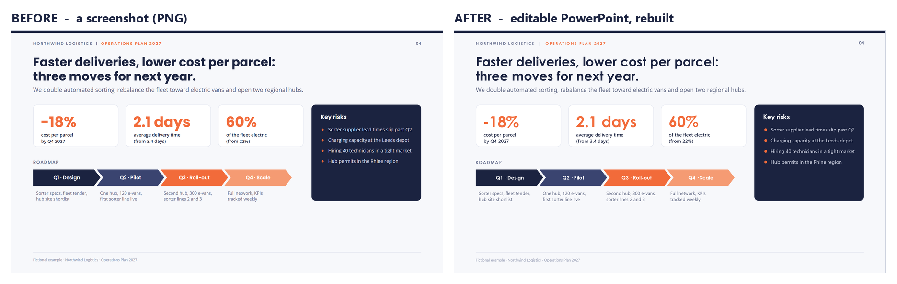

<p align="center"></p>

<h1 align="center">unscreenshot</h1>

<p align="center"><b>Undo the screenshot. Get the slide back.</b><br>
Screenshot in, editable PowerPoint out, pixel for pixel, in any language.</p>

<p align="center">
  <b title="English">🇬🇧</b> ·
  <a href=".github/readme/README.fr.md" title="Français">🇫🇷</a> ·
  <a href=".github/readme/README.zh-CN.md" title="简体中文">🇨🇳</a> ·
  <a href=".github/readme/README.es.md" title="Español">🇪🇸</a> ·
  <a href=".github/readme/README.pt-BR.md" title="Português (Brasil)">🇧🇷</a> ·
  <a href=".github/readme/README.ja.md" title="日本語">🇯🇵</a> ·
  <a href=".github/readme/README.vi.md" title="Tiếng Việt">🇻🇳</a> ·
  <a href=".github/readme/README.ko.md" title="한국어">🇰🇷</a> ·
  <a href=".github/readme/README.fa.md" title="فارسی">🇮🇷</a> ·
  <a href=".github/readme/README.th.md" title="ไทย">🇹🇭</a> ·
  <a href=".github/readme/README.ar.md" title="العربية">🇸🇦</a>
</p>

<p align="center">
  <a href="LICENSE"></a>
  <a href="https://github.com/zaidlemouakni/unscreenshot/actions/workflows/ci.yml"></a>
  
</p>


You have a picture of a slide: a screenshot from a meeting, a slide an AI generated as an image, a page of a PDF, a deck someone sent as pictures. You need the PowerPoint. It's gone, or it never existed.

`unscreenshot` is an **agent skill**: give your AI assistant the image, get back a `.pptx` where every text box, bullet, card, line and colour is measured on the image and rebuilt as a native, editable PowerPoint object.

## Install in 30 seconds

Paste this into any agent that can install skills (Claude Code, Codex, Gemini CLI, Cursor, Copilot…):

```text
Install the unscreenshot skill from https://github.com/zaidlemouakni/unscreenshot, follow the repo's AGENTS.md.
```

Or pick your platform:

| Where you use AI | How |
|---|---|
| **Claude** (claude.ai) | Settings > Capabilities: turn on code execution, then Skills > upload [`unscreenshot.zip`](https://github.com/zaidlemouakni/unscreenshot/releases/latest) |
| **ChatGPT** (Business, Enterprise, Edu) | Skills > upload the same zip |
| **Gemini** (app) | Skills > upload the same zip |
| **Microsoft Copilot Studio** | Agent > Build > Skills > Upload a skill > the zip |
| **Claude Code** | `claude plugin marketplace add zaidlemouakni/unscreenshot` then `claude plugin install unscreenshot@unscreenshot` |
| **Codex** | `codex plugin marketplace add zaidlemouakni/unscreenshot --ref main` then `codex plugin add unscreenshot@unscreenshot` |
| **Gemini CLI** | `gemini extensions install https://github.com/zaidlemouakni/unscreenshot` |
| **Mistral Vibe** | copy `skills/unscreenshot` into `~/.vibe/skills/` |
| **GitHub Copilot, Cursor, OpenCode, others** | `npx skills add zaidlemouakni/unscreenshot` |

Menus, folders and every platform step by step: [INSTALL.md](INSTALL.md).

## Try it in 60 seconds

1. Install the skill for your platform (above).
2. Save [the sample screenshot](examples/demo/source.png), or use any picture of a slide.
3. Attach it and ask, in your own language:
   > Rebuild this slide as an editable PowerPoint, identical.
4. Open the `.pptx` and click the title: it's a real text box, not a picture.

You also get a before/after image to compare. Several images, or a PDF with several pages, give one slide each in the same file.

## Works in your language


Arabic, Persian and Hebrew (right to left), Chinese, Japanese, Korean, Hindi, Thai, Vietnamese, Russian, Greek and every language written in Latin letters.

- Text stays word for word, in its own script. Nothing is translated.
- Right-to-left slides keep their mirrored layout: bullets on the right, roadmaps pointing left.
- Each script gets the font PowerPoint uses for it, and its size is measured the way that script is drawn.

Full examples: [Arabic](examples/arabic) · [Japanese](examples/japanese) · [twelve scripts on one slide](examples/languages).

## What you get



- **Native, editable objects**: text boxes with the real text, real bullets, rectangles, rounded cards, pills, circles, chevrons, lines, groups. Change a word, recolour a card, move a block: it's a normal slide.
- **Measured, not guessed**: positions, sizes and colours come from pixel measurements. Font sizes are computed so each line has the same width as in the image.
- **A proof**: the image and the rebuilt slide side by side, and their overlay.

## Why not OCR, a PDF converter or an AI slide generator?

OCR gives you the text, not the slide. A converter needs the original PDF. A generator makes a new slide. unscreenshot gives you back the slide you have.

| | OCR | PDF converters | AI slide generators | **unscreenshot** |
|---|:-:|:-:|:-:|:-:|
| Starts from a screenshot or a photo | ✅ | ❌ | ❌ | ✅ |
| Every word kept, verbatim | ✅ | ✅ | ❌ | ✅ |
| Same layout, positions and sizes | ❌ | ⚠️ | ❌ | ✅ |
| Native shapes, cards and real bullets | ❌ | ⚠️ | ✅ | ✅ |
| Right to left and non-Latin scripts | ⚠️ | ⚠️ | ⚠️ | ✅ |

⚠️ depends on the tool and the file.

## How it works

The assistant (any model that can see images) only reads the text. Small, tested Python scripts do everything else, so the result is the same with a small model or a large one.

1. **Analyse**: find every text line, filled shape, rule, bullet dot and icon; measure baselines, ink widths and colours.
2. **Read**: the model types each text line from enlarged crops; the scripts flag any line whose reading does not fit the image.
3. **Spec**: the scripts write the slide's description from the measurements: shapes, chevrons, bullets, fonts, sizes, alignment.
4. **Fit**: font sizes are solved so each text's ink width matches the image, script by script.
5. **Build**: a dependency-free writer produces the `.pptx` (Pillow and numpy only).
6. **Check**: the slide is rendered (LibreOffice or PowerPoint), compared with the image, and corrected, three rounds at most.

On the four examples of this repository, every text lands within 1 px of the original after one correction.

## Limits

- **Fonts**: when the image uses a font that isn't an Office font (Poppins, Inter, Noto…), the closest Office font is used. Positions, sizes and line widths still match; letter shapes differ slightly.
- **Icons, logos, photos** are cropped from the image (with a transparent background), not redrawn.
- **Vertical Japanese or Chinese text** is kept as an image.
- Your assistant needs to be able to **run Python** (code execution). Without it, use the MCP server planned for v2.

## FAQ

**Is it free?**\
Yes: MIT-licensed, no account, no API key. It runs inside the assistant you already use.

**Does my slide leave my computer?**\
The skill makes no network calls: its scripts run in your assistant's sandbox or on your machine. Your assistant sees the image, like any file you share with it.

**Which assistants does it work with?**\
Any assistant that can see images and run Python: the ones in the install table, and others that read the `SKILL.md` format. Reading small text depends on the model's vision: a stronger model reads better.

**What if a detail is off?**\
The skill renders its result, compares it with your image and corrects it, three rounds at most. Then it tells you what still differs. Everything is editable, so the last touch takes seconds.

**Why not just paste the image into PowerPoint?**\
Then it's a picture: you can't change a word, fix a number or reuse a card.

**Can it improve or translate the slide?**\
Not on its own, on purpose: it rebuilds what the image shows, word for word, typos included. Once you have the real PowerPoint, ask your assistant for any change you like.

## Repository

| Path | What |
|---|---|
| `skills/unscreenshot/` | The skill: `SKILL.md`, `scripts/`, `reference/` (spec format, full example) |
| `examples/` | Fictional slides with their spec and rebuilt `.pptx`: [demo](examples/demo), [arabic](examples/arabic), [japanese](examples/japanese), [languages](examples/languages) |
| `tests/` | Unit and round-trip tests (`python -m unittest discover -s tests -v`) |
| `scripts/package_skill.py` | Builds the uploadable zips into `dist/` |

Contributions welcome, especially hard slides and fixes to the translations: see [CONTRIBUTING.md](CONTRIBUTING.md).

## License

MIT.

*Star it if it saved you from rebuilding one slide by hand.*
